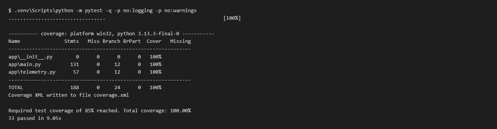
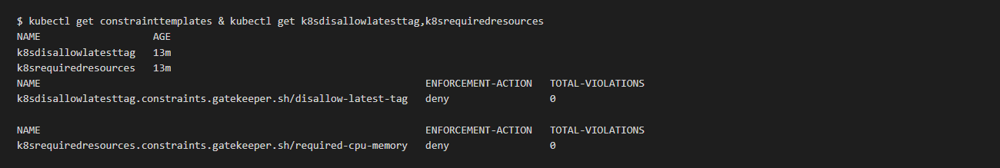
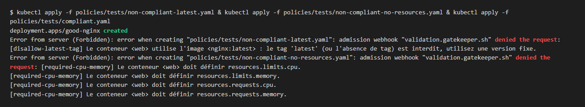
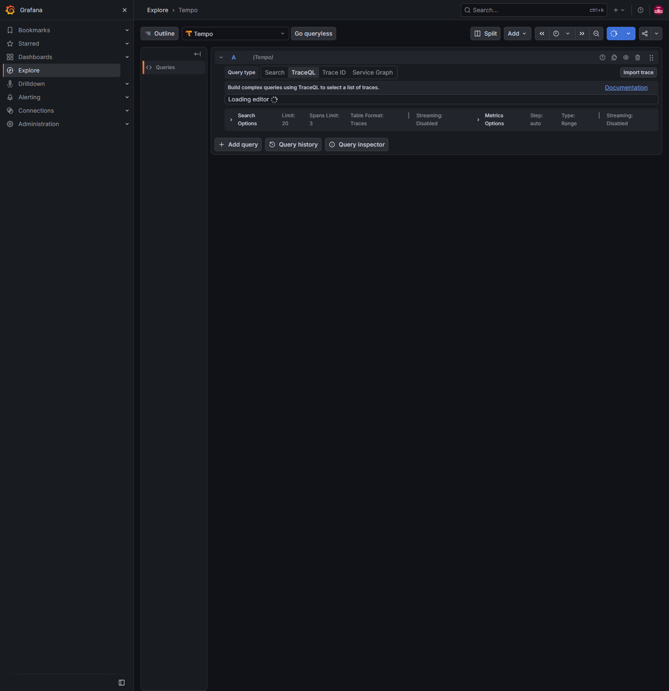
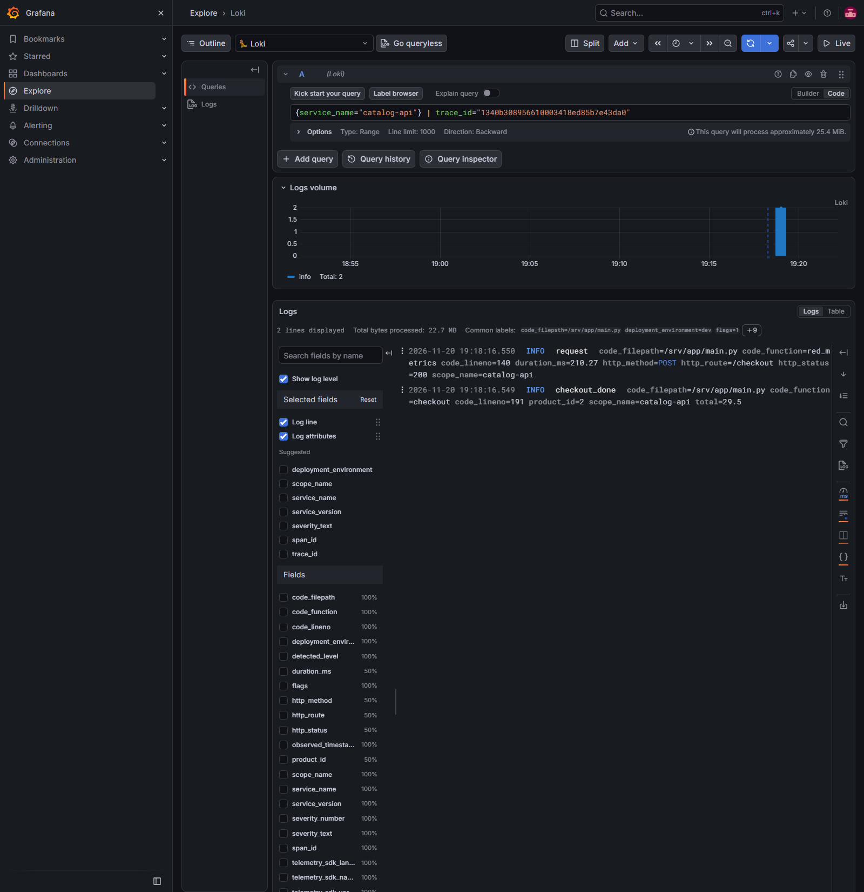
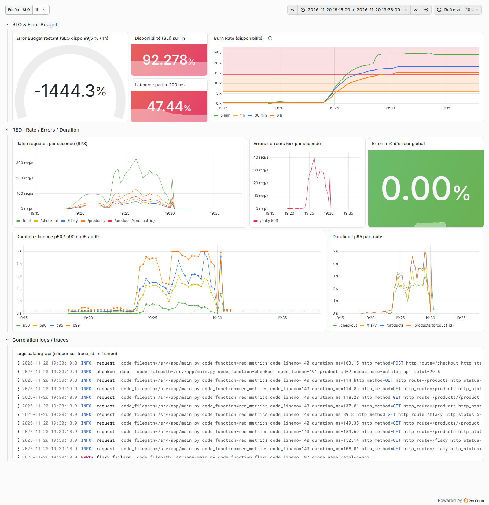
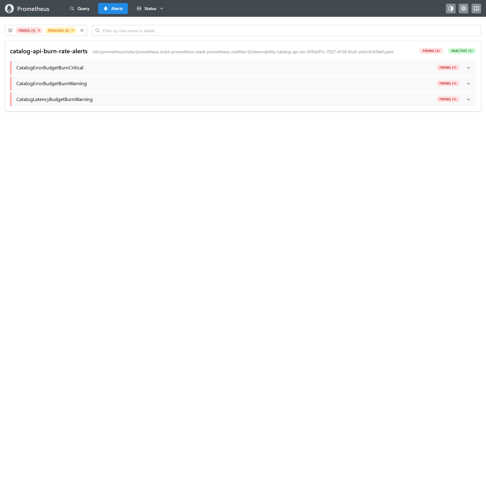
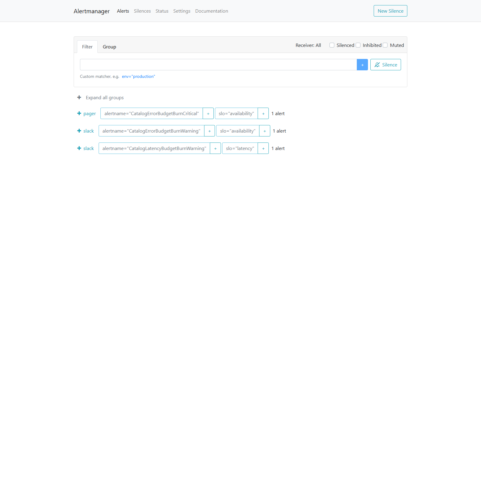

# Rapport SRE : Continuous Delivery, Quality & Security Gates et observabilité cloud-native

**TP2 DevOps avancé**, microservice `catalog-api`
Auteur : Ramy Kaabi (`ramykaabi20`), 20 novembre 2026
Dépôt : https://github.com/ramykaabi20/tp2-devops-catalog

---

## 1. Architecture

```
 Développeur ──push/PR──▶ GitHub Actions ─────────────────────────────────────────────┐
                           │ 1. Lint (ruff) + pytest (couverture ≥ 85 %, Cobertura)    │
                           │ 2. SonarCloud + Quality Gate (bloquant)                   │
                           │ 3. docker build                                           │
                           │ 4. Trivy (CRITICAL = échec)                               │
                           │ 5. push ghcr.io/ramykaabi20/catalog-api:sha-xxxxxxx       │
                           │ 6. commit image.tag dans helm/catalog-api/values.yaml     │
                           ▼                                                           │
                     Dépôt Git (source de vérité) ◀──── ArgoCD (auto-sync, self-heal) ◀┘
                                                              │ helm template + apply
                                                              ▼
 ┌──────────────────────────── Kubernetes (Minikube) ─────────────────────────────────┐
 │  API Server ──▶ Webhook OPA Gatekeeper (pas de :latest, requests/limits requis)     │
 │                                                                                     │
 │  ns catalog : catalog-api (FastAPI + SDK OpenTelemetry) ×3                          │
 │     /metrics ◀── Prometheus (scrape des pods annotés) ──▶ Alertmanager ──▶ Page/Slack│
 │     OTLP ──▶ OpenTelemetry Collector ──▶ Tempo (traces)                             │
 │                                       └─▶ Loki  (logs JSON + trace_id)              │
 │  Grafana : dashboard RED / Error Budget, Explore Loki ⇄ Tempo ⇄ Prometheus          │
 │  ns catalog : Job k6 (ramp-up 100 VU, stress 500 VU, spike 1500 VU)                 │
 └─────────────────────────────────────────────────────────────────────────────────────┘
```

| Domaine | Choix |
|---|---|
| Microservice & tests | Python 3.12, FastAPI, pytest + pytest-cov |
| Qualité & SecOps | SonarCloud (Quality Gate), Trivy |
| Policy enforcement | OPA Gatekeeper 3 (ConstraintTemplates Rego) |
| CI/CD | GitHub Actions, GHCR, ArgoCD (Helm) |
| Cluster | Minikube 1.38 (Kubernetes 1.31, 6 vCPU, 5 Go) |
| Observabilité | SDK OpenTelemetry, OTel Collector, Prometheus, Grafana, Loki 3, Tempo |
| SRE & charge | k6, Prometheus Alertmanager |

---

## 2. Étape 1 : microservice et couverture de tests

### 2.1 API

| Endpoint | Rôle |
|---|---|
| `GET /products`, `GET/DELETE /products/{id}`, `POST /products` | CRUD du catalogue (validation Pydantic : nom 1 à 100 caractères, prix > 0, stock ≥ 0) |
| `POST /checkout` | Traitement **lent** simulé (latence aléatoire, 30 à 220 ms en production), réservation de stock, spans `checkout.process` et `payment.authorize` |
| `GET /flaky` | Erreurs **intermittentes** : 503 avec une probabilité `FLAKY_ERROR_RATE` (2 % en nominal) |
| `GET /metrics` | Format Prometheus (et OpenMetrics avec *exemplars* `trace_id`) |
| `GET /health` | Sondes readiness / liveness |

Les métriques RED sont exposées par l'application :

- `http_requests_total{method, route, status}` (compteur) ;
- `http_request_duration_seconds{method, route}` (histogramme). Ses buckets contiennent **exactement 0,2 s**, ce qui permet de calculer le SLI de latence sans interpolation.

Le label `route` reprend le gabarit de la route (`/products/{product_id}`) et non l'URL réelle, pour éviter l'explosion de cardinalité.

### 2.2 Tests

33 tests (`tests/test_api.py`) :

- **Cas nominaux** : santé, liste, lecture, création puis suppression, checkout (total et décrément du stock), `/flaky` en succès et en échec.
- **Cas aux limites** : identifiant inconnu (404), identifiant non entier (422), six charges utiles invalides (nom vide ou de 101 caractères, prix nul ou négatif, stock négatif, champ manquant), quantité 0, -1 ou 101 (422), achat de tout le stock puis rupture (409), produit inconnu au checkout, bornes de latence inversées, taux d'erreur hors de [0 ; 1] (borné).
- **Observabilité** : présence des séries RED et du bucket `le="0.2"`, format OpenMetrics, comptage des 5xx, log JSON portant `trace_id` et `span_id`, et log `request` émis **dans** le span de la requête (corrélation).

Le rapport Cobertura est écrit dans `coverage.xml`. Le seuil est imposé par `--cov-fail-under=85` : la CI échoue en dessous.



**Résultat : 100 % de couverture (lignes et branches), 33/33 tests verts.**

---

## 3. Étape 2 : Quality Gate SonarQube et OPA Gatekeeper

### 3.1 Quality Gate SonarCloud

Le job `sonar` envoie `coverage.xml` à SonarCloud (`sonar.python.coverage.reportPaths`). L'action `sonarqube-quality-gate-action` **fait échouer la pipeline** si la Quality Gate est rouge. Les jobs suivants (build, scan, push, déploiement) dépendent de `sonar` via `needs:` et ne s'exécutent donc pas.

Conditions de la Quality Gate personnalisée « TP2 Gate » (sur le *New Code*) :

| Métrique | Condition d'échec |
|---|---|
| Coverage on New Code | < 85 % |
| Security Hotspots Reviewed on New Code | < 100 % (au moins 1 hotspot non revu bloque) |
| Duplicated Lines (%) on New Code | > 3 % |
| (hérité de *Sonar way*) Reliability / Security Rating | pire que A |

SAST : profil *Sonar way* pour Python, qui couvre bugs, code smells, vulnérabilités et hotspots.

> **Démonstration de la PR non conforme** : voir la section 8.1.

### 3.2 OPA Gatekeeper

Deux `ConstraintTemplate` écrits en Rego (`policies/gatekeeper/templates/`) :

1. **`K8sDisallowLatestTag`** refuse toute image `:latest` **ou sans tag**, puisque l'absence de tag équivaut à `latest`. Le contrôle s'applique aux `containers`, `initContainers` et `ephemeralContainers`. Le tag est lu après le dernier `/`, pour ne pas confondre `registry:5000/app` avec un tag. Une image épinglée par digest (`@sha256:`) est acceptée.
2. **`K8sRequiredResources`** impose `requests.cpu`, `requests.memory`, `limits.cpu` et `limits.memory` sur chaque conteneur. La liste est paramétrable dans la Constraint.

Les Constraints (`enforcementAction: deny`) visent les **Pods et les workloads** : Deployment, StatefulSet, DaemonSet, ReplicaSet, Job et CronJob. Le refus a donc lieu dès `kubectl apply` ou dès la synchronisation ArgoCD, au niveau de l'API Server, et pas plus tard dans les événements du ReplicaSet. Les namespaces d'infrastructure (`kube-system`, `gatekeeper-system`, `argocd`, `observability`) sont exclus.



**Rejet automatique par l'API Server** (sortie réelle) :



Le manifeste conforme (`nginx:1.27.3` avec requests et limits) est admis. Les deux manifestes non conformes sont refusés en `Forbidden` par le webhook `validation.gatekeeper.sh`, avec un message explicite. Le chart `catalog-api` respecte les deux règles : tag `sha-<commit>` et resources définies.

---

## 4. Étape 3 : pipeline CI/CD et GitOps

`.github/workflows/ci.yml`, déclenché sur `pull_request` et `push` vers `main` :

| Job | Contenu | Bloquant |
|---|---|---|
| `lint-test` | `ruff check`, `ruff format --check`, `pytest` (couverture ≥ 85 %), artefact `coverage.xml` | oui |
| `sonar` | Analyse SonarCloud et attente du statut de la Quality Gate | oui |
| `build-scan-push` | `docker build`, **Trivy** `--severity CRITICAL --ignore-unfixed --exit-code 1`, rapport SARIF (CRITICAL+HIGH) envoyé dans l'onglet *Security*, push sur GHCR (sur `main` seulement) | oui |
| `gitops-update` | Écrit `image.tag: sha-xxxxxxx` dans `helm/catalog-api/values.yaml`, commit `[skip ci]` | n/a |

**Gestion des secrets** : aucun secret dans le dépôt.

- `SONAR_TOKEN` est un *GitHub Actions secret* ; l'organisation et la clé du projet SonarCloud sont des *variables*.
- Le push GHCR et le commit GitOps utilisent le `GITHUB_TOKEN` éphémère, avec des permissions minimales déclarées dans le workflow (`packages: write`, `contents: write`).
- Le mot de passe Grafana de la démo reste dans les values du lab ; en production, il irait dans un `Secret` géré par External Secrets ou Sealed Secrets.

**Déploiement continu (ArgoCD)** : l'`Application` `argocd/application.yaml` suit `main` / `helm/catalog-api` avec `automated: {prune, selfHeal}`. Chaque commit de la CI qui change `image.tag` est déployé automatiquement. Toute modification manuelle dans le cluster est annulée (*self-heal*). Si un manifeste non conforme arrive par Git, ArgoCD affiche la synchronisation en échec avec le message de Gatekeeper : la politique s'applique aussi au chemin GitOps.

**Image** : build multi-stage `python:3.12-slim-bookworm`, `apt-get upgrade` pour réduire les CVE, utilisateur non-root (UID 10001), `readOnlyRootFilesystem`, `allowPrivilegeEscalation: false`.

---

## 5. Étape 4 : instrumentation et stack d'observabilité

### 5.1 Instrumentation OpenTelemetry (`app/telemetry.py`)

- **Traces** : `TracerProvider` du SDK, instrumentation automatique FastAPI (span serveur par requête), spans métier `checkout.process` et `payment.authorize` avec attributs (`catalog.product_id`, `catalog.total`…). Export OTLP/HTTP vers le Collector.
- **Logs structurés JSON** : un `JsonFormatter` ajoute `trace_id` et `span_id` du span courant à chaque log sur stdout. Un `LoggingHandler` OTel envoie les mêmes logs en OTLP, avec le contexte de trace natif.
- **Métriques** : RED via `prometheus_client`, avec un **exemplar `trace_id`** sur chaque observation de l'histogramme (métrique → trace).
- Point d'attention corrigé pendant le TP : l'instrumentation FastAPI doit être ajoutée **après** le middleware de métriques, pour l'envelopper. Sinon le log `request` et l'exemplar sont produits hors du span et perdent le `trace_id`. Un test de non-régression couvre ce cas.

### 5.2 Stack déployée (Helm, `observability/`)

| Composant | Rôle |
|---|---|
| Prometheus (kube-prometheus-stack) | `additionalScrapeConfigs` `kubernetes-pods` : **découverte automatique des pods annotés** `prometheus.io/scrape|port|path`. Stockage des exemplars activé. Règles SLO via `PrometheusRule`. |
| OpenTelemetry Collector (contrib) | Récepteur OTLP. Pipeline `traces` → Tempo (OTLP gRPC), pipeline `logs` → Loki (`/otlp`), avec `memory_limiter` et `batch`. |
| Loki 3 (single binary) | Logs. `trace_id` stocké en *structured metadata*. |
| Tempo | Traces. |
| Grafana | Sources de données Prometheus, Loki et Tempo **liées entre elles** (voir ci-dessous). |
| Alertmanager | Routage `severity=critical` → page, `severity=warning` → Slack. |

**Liens Traces ↔ Logs ↔ Métriques par la propagation du `trace_id`** :

- Loki → Tempo : *derived field* `trace_id`. Chaque ligne de log a un lien « Voir la trace ».
- Tempo → Loki : `tracesToLogsV2` avec la requête `{service_name="catalog-api"} | trace_id="${__trace.traceId}"`.
- Prometheus → Tempo : *exemplars* de l'histogramme de latence.

Vérification réalisée sur le cluster : la trace `58fad190…c2ed47` (`POST /checkout`, 78 ms) retrouvée dans Tempo et ses logs (`checkout_done`, `request`) retrouvés dans Loki avec le même `trace_id`.

**Trace Tempo** d'un `POST /checkout` (255 ms) : span serveur, `checkout.process` → `payment.authorize`. Le bouton *Logs for this trace* ouvre Loki directement :



**Logs Loki filtrés sur le même `trace_id`** : la requête et l'événement métier `checkout_done` sont retrouvés à partir de la trace.



---

## 6. Étape 5 : ingénierie SRE

### 6.1 Contrat de service (SLI / SLO)

| SLO | SLI (PromQL) | Objectif | Error budget |
|---|---|---|---|
| Disponibilité | `1 - sum(rate(http_requests_total{status=~"5.."}[w])) / sum(rate(http_requests_total[w]))` | 99,5 % des requêtes avec status < 500 | 0,5 % des requêtes |
| Latence | `sum(rate(http_request_duration_seconds_bucket{le="0.2"}[w])) / sum(rate(http_request_duration_seconds_count[w]))` | 95 % des requêtes < 200 ms (p95 ≤ 200 ms) | 5 % de requêtes lentes |

Fenêtre glissante de **30 jours**. Les 4xx (erreurs client, comme 404, 409 ou 422) ne consomment pas le budget.

**Calcul de l'error budget** :

- En requêtes : budget = (1 − 0,995) × N. Pour un trafic nominal de 100 req/s sur 30 jours, N = 100 × 86 400 × 30 = 259,2 M requêtes, soit **1 296 000 requêtes en erreur autorisées**.
- En temps (panne totale équivalente) : 0,005 × 30 j = 0,15 j = **3 h 36 min**.
- **Budget restant** = 1 − (taux d'erreur observé sur 30 j / 0,005). Il vaut 100 % sans erreur, 0 % quand le budget est épuisé, et devient négatif au-delà (SLO violé).

```promql
# catalog:error_budget_remaining:ratio30d
1 - ( sum(increase(http_requests_total{app="catalog-api",status=~"5.."}[30d]))
    / sum(increase(http_requests_total{app="catalog-api"}[30d])) ) / 0.005
```

### 6.2 Alerting multi-window multi-burn-rate

Le **burn rate** est la vitesse de consommation du budget, rapportée à une consommation régulière (burn rate 1 = budget épuisé pile en 30 jours) :

$$\text{burn rate} = \frac{\text{taux d'erreur}}{1 - \text{SLO}} \qquad \text{budget consommé sur } W = \text{burn rate} \times \frac{W}{30\,\text{j}}$$

| Alerte | Budget consommé | Fenêtre longue | Burn rate | Seuil de taux d'erreur | Fenêtre courte | Destination |
|---|---|---|---|---|---|---|
| **Critical** | 2 % | 1 h | 0,02 × 720 / 1 = **14,4** | 14,4 × 0,5 % = **7,2 %** | 5 min | Page (astreinte) |
| **Warning** | 5 % | 6 h | 0,05 × 720 / 6 = **6** | 6 × 0,5 % = **3 %** | 30 min | Slack `#sre-alerts` |

La fenêtre courte (1/12 de la longue) doit **aussi** dépasser le seuil. L'alerte part donc vite quand l'incident commence, et se résout vite après la correction, au lieu de rester active une heure à cause de l'historique de la fenêtre longue. À burn rate 14,4, le budget mensuel est épuisé en 30 j / 14,4 ≈ **2 jours** ; à burn rate 6, en **5 jours**.

```yaml
- alert: CatalogErrorBudgetBurnCritical
  expr: catalog:sli_errors:ratio_rate1h > (14.4 * 0.005)
        and catalog:sli_errors:ratio_rate5m > (14.4 * 0.005)
  for: 1m
  labels: { severity: critical, slo: availability }
- alert: CatalogErrorBudgetBurnWarning
  expr: catalog:sli_errors:ratio_rate6h > (6 * 0.005)
        and catalog:sli_errors:ratio_rate30m > (6 * 0.005)
  for: 2m
  labels: { severity: warning, slo: availability }
```

Les mêmes paires de seuils sont appliquées au SLO de latence (budget 5 %). Toutes les règles sont dans `observability/slo-rules.yaml` : *recording rules* pour les ratios 5m/30m/1h/6h/30d, burn rates, budget restant et alertes.

### 6.3 Dashboard Grafana SRE (méthode RED)

`observability/dashboards/catalog-sre.json` (généré par `scripts/build_dashboard.py`, provisionné par ConfigMap) :

- **Rate** : RPS total et par route.
- **Errors** : erreurs 5xx/s par route et statut, % d'erreur global (seuils 0,5 % et 7,2 %).
- **Duration** : p50, p90, p95 et p99 (`histogram_quantile`) avec un repère à 200 ms, et p95 par route.
- **Error Budget Remaining** : jauge dynamique sur une fenêtre réglable (`$window` : 1h / 6h / 24h / 30d), plus les SLI de disponibilité et de latence.
- **Burn rate** 5m / 30m / 1h / 6h avec les seuils 6 et 14,4 tracés.
- **Logs** Loki de l'application, avec un lien vers la trace.

### 6.4 Scénarios k6

`k6/load-test.js`, exécuté **dans le cluster** (`k6/k6-job.yaml`) pour éviter le goulot d'un `port-forward` :

| Scénario | Profil | Début |
|---|---|---|
| `ramp_up` | 0 → 100 VU en 2 min, palier de 2 min | 0 s |
| `stress` | 0 → 500 VU en 1 min, **palier prolongé de 5 min** | 4 min 40 s |
| `spike` | 0 → **1500 VU en 10 s**, maintenu **30 s**, puis retour à 0 | 11 min 20 s |

Parcours utilisateur : 40 % liste, 25 % fiche produit, 20 % checkout, 15 % `/flaky`, avec un temps de réflexion de 0,5 à 1,5 s. Les **seuils k6 reprennent les SLO** (`server_errors < 0,5 %`, `p(95) < 200 ms`), au global et par scénario.

---

## 7. Analyse d'incident simulé (post-mortem)

> Les heures sont en **UTC**. Les captures Grafana affichent l'heure locale (UTC+1).

### 7.1 Run 1 : panne en cascade révélée par le stress test

Configuration initiale : 2 réplicas, `limits.cpu: 500m`, liveness probe par défaut (timeout 1 s, 3 échecs).

À 500 VU, les deux pods saturent leur CPU. `/health` ne répond plus en moins de 1 s, la **liveness probe tue les pods**, et le trafic se reporte sur le pod restant, qui sature à son tour. C'est une **boucle de redémarrages**, et les sondes aggravent la panne au lieu de la contenir. Événements Kubernetes réels :

```
Normal    Killing     pod/catalog-api-…-ftrxc  Container api failed liveness probe, will be restarted
Warning   Unhealthy   pod/catalog-api-…-ftrxc  Liveness probe failed: Get "http://10.244.0.30:8000/health":
                                               context deadline exceeded (Client.Timeout exceeded while awaiting headers)
Warning   Unhealthy   pod/catalog-api-…-tf485  Readiness probe failed: … context deadline exceeded
```

**Enseignement SRE : l'angle mort des métriques côté serveur.** Pendant ce run, Prometheus ne voyait qu'environ **26 req/s pour près de 400 req/s envoyées** :

- un pod qui redémarre perd ses compteurs ;
- un pod saturé ne répond plus au scrape (`context deadline exceeded`) ;
- les requêtes refusées (connexion impossible) ne sont jamais comptées par l'application.

Le burn rate affichait donc un faux **0,6** en pleine panne. Un SLI de disponibilité mesuré **uniquement dans l'application** sous-estime les pannes franches. En production, il faut le compléter par une mesure au **load balancer / ingress** et par des **sondes synthétiques** (blackbox exporter).

Le run 1 a aussi fait planter l'environnement : le disque du poste était plein. Les mesures de ce run n'ont donc servi qu'au diagnostic, et le run 2 a été rejoué sur une configuration corrigée :

| Action corrective | Avant | Après |
|---|---|---|
| Liveness probe | timeout 1 s, 3 échecs | `timeoutSeconds: 5`, `failureThreshold: 6`, `initialDelaySeconds: 10` |
| Readiness probe | timeout 1 s | `timeoutSeconds: 3` (retire le pod du Service sans le tuer) |
| Capacité | 2 × 500m CPU | 3 × 1 CPU (`requests.cpu: 250m`) |

### 7.2 Run 2 : release défectueuse sous charge

Scénario : charge k6 complète. Pendant le palier de stress, une release défectueuse est déployée (`FLAKY_ERROR_RATE=0.8`, soit 80 % d'erreurs 503 sur `/flaky`). Elle est ensuite annulée par `helm rollback`.

**Chronologie**

| Heure (UTC) | Événement |
|---|---|
| 18:18:06 | Démarrage k6 (release saine, révision 4) |
| 18:22:46 | Début du stress test 500 VU |
| 18:23:26 | **Déploiement de la release défectueuse** |
| 18:24:09 | Release défectueuse en ligne (rolling update terminé) |
| **18:25:27** | **`CatalogErrorBudgetBurnWarning` FIRING** → Slack (+1 min 18 s) |
| 18:25:42 | `CatalogLatencyBudgetBurnWarning` FIRING (latence) |
| 18:29:26 | Spike 0 → 1500 VU en 10 s, maintenu 30 s |
| 18:29:27 | `CatalogErrorBudgetBurnCritical` PENDING (burn rate 1 h = 14,49 > 14,4) |
| **18:30:27** | **`CatalogErrorBudgetBurnCritical` FIRING** (+6 min 18 s) |
| 18:30:42 | **Page reçue** par le récepteur d'astreinte |
| 18:31:10 → 18:31:45 | **Mitigation** : `helm rollback catalog-api 4` |
| **18:35:48** | **Alerte Critical RESOLVED** (la fenêtre courte de 5 min repasse sous le seuil) |

Notification réelle reçue par le récepteur d'astreinte :

```
18:30:42 [PAGE (astreinte)] FIRING CatalogErrorBudgetBurnCritical severity=critical - catalog-api brûle son error budget 14,4x trop vite (2 % du budget en 1 h)
18:35:48 [PAGE (astreinte)] RESOLVED CatalogErrorBudgetBurnCritical severity=critical - catalog-api brûle son error budget 14,4x trop vite (2 % du budget en 1 h)
```

**Résultats k6 (côté client, sortie réelle)**

```
===== Résumé k6 catalog-api =====
Requêtes : 121097 (165.5 req/s)
Erreurs serveur (5xx/timeout) : 10.568 %
Latence p50=523.5 ms  p90=2552.5 ms  p95=3385.8 ms  p99=9997.9 ms  max=12117.2 ms
VU max : 1500
Seuils :
  KO   http_req_duration p(95)<200
  KO   server_errors{scenario:spike} rate<0.005
  KO   server_errors rate<0.005
  KO   http_req_duration{scenario:spike} p(95)<200
  KO   http_req_duration{scenario:stress} p(95)<200
  KO   http_req_duration{scenario:ramp_up} p(95)<200
```

**Résultats par phase (côté serveur, Prometheus)**

| Phase | Débit | Erreurs 5xx | p95 | p99 | Requêtes < 200 ms | Burn rate 5 min / 1 h |
|---|---|---|---|---|---|---|
| Ramp-up 0 → 100 VU, release saine | 69,8 req/s | 0,38 % | 199 ms | 322 ms | **95,1 %** | 0,7 / 0,7 |
| Stress 500 VU, release saine | 207,0 req/s | 1,35 % | 1 937 ms | 3 632 ms | 72,2 % | 1,6 / 1,2 |
| Stress 500 VU, **release défectueuse** | 233,3 req/s | **12,15 %** | 2 576 ms | 4 860 ms | 27,1 % | **24,3 / 14,3** |
| Spike 1500 VU, **release défectueuse** | 201,1 req/s | **12,28 %** | 4 559 ms | 4 939 ms | 4,2 % | **24,4 / 14,5** |

**Dashboard Grafana pendant l'incident** (burn rate, RED, logs) :



**Alertes Prometheus déclenchées** (Critical + Warning disponibilité, Warning latence) :



**Alertmanager** (routage `severity` → récepteurs `pager` et `slack`) :



### 7.3 Analyse

**1. Ramp-up (100 VU) : les deux SLO tiennent.** Le service est au SLO de latence (95,1 % < 200 ms, p95 = 199 ms) et de disponibilité (0,38 % d'erreurs < 0,5 %). Le burn rate est de 0,7 : sans incident, le budget mensuel serait consommé à 70 %. La différence entre ces 0,38 % et le seuil k6 (KO sur le ramp-up) vient de la latence réseau et de la file d'attente vues par le client, que le serveur ne mesure pas.

**2. Stress (500 VU) : limite de capacité, indépendamment de l'incident.** Avant même la release défectueuse, le débit plafonne vers **210 req/s** (3 processus Python mono-cœur) et le p95 passe de 0,2 à 1,9 s. Les requêtes attendent dans la file d'Uvicorn. Le SLO de latence est violé par **saturation** (U de la méthode USE), sans aucune erreur applicative. Le budget de latence brûle (alerte `CatalogLatencyBudgetBurnWarning`).

**3. Release défectueuse : 12 % d'erreurs, burn rate 24.** 15 % du trafic va sur `/flaky`, à 80 % d'échec, soit 12 % d'erreurs attendues. La mesure donne 12,15 %, donc la métrique est fiable quand les pods restent vivants (contrairement au run 1). Burn rate = 12,15 % / 0,5 % ≈ **24** : à ce rythme, le budget mensuel est épuisé en **30 j / 24 ≈ 30 heures**.

**4. Spike (1500 VU) : le débit n'augmente pas, la latence explose.** Le débit servi baisse même (201 req/s) : la saturation est totale. Le p95 atteint 4,6 s et seulement 4,2 % des requêtes passent sous 200 ms. Côté client, le p99 atteint 10 s, c'est-à-dire des **timeouts** (`timeout: 10s` dans k6) comptés comme erreurs par k6 mais **invisibles côté serveur**. C'est le même angle mort qu'au run 1.

**5. Comportement des alertes multi-window.**

- **Warning (6 h / 30 min, ×6)** : déclenchée **78 s** après la mise en ligne. Les 30 min glissantes dépassent vite 3 % avec 12 % d'erreurs.
- **Critical (1 h / 5 min, ×14,4)** : déclenchée en **6 min 18 s**. La fenêtre courte (5 min) dépassait le seuil dès 18:25, mais l'alerte attend que **la fenêtre longue de 1 h** dépasse aussi 7,2 %. Le temps de détection théorique pour une alerte de fenêtre W et de seuil B, face à un burn rate b, est W × B / b = 60 min × 14,4 / 24 ≈ **36 min** avec une heure complète d'historique sain. Ici, Prometheus n'avait que 11 min d'historique, d'où la détection plus rapide. C'est le compromis assumé de cette méthode : une **panne totale (100 % d'erreurs, burn rate 200) déclenche la page en ≈ 4,3 min** (60 × 14,4 / 200), alors qu'une dégradation partielle comme celle-ci est d'abord remontée par la Warning, puis par la page si elle persiste assez longtemps pour menacer réellement le budget.
- **Résolution** : 4 min après le rollback, la condition `and` sur la fenêtre de 5 min fait tomber l'alerte Critical, alors que le burn rate 1 h reste au-dessus de 14,4 pendant presque une heure (voir le graphe). Sans fenêtre courte, l'astreinte serait restée bipée une heure pour un incident déjà résolu.

**6. Error budget consommé.**

- Sur l'ensemble du test (16 min) : **10 865 erreurs sur 119 947 requêtes (9,06 %)**. Sur une fenêtre de 1 h, la disponibilité est de **92,28 %** (jauge Grafana), soit 18 fois le budget de la fenêtre : la jauge « budget restant » descend à −1444 %.
- Rapporté au **budget mensuel** (SLO 99,5 % sur 30 j) au débit moyen du test (125 req/s) : 125 × 2 592 000 × 0,005 = **1 620 000 erreurs autorisées par mois**. L'incident en a consommé 10 865, soit **0,67 % du budget mensuel** en 7 minutes. S'il avait duré **1 heure** au même rythme, il aurait consommé environ 5 % du budget. À burn rate 24 non corrigé, le budget mensuel entier part en environ 30 heures.

**7. L'observabilité doit tenir la charge.** Pendant le spike, **Tempo a redémarré 5 fois** (limite mémoire de 512 Mi atteinte) et a perdu des traces, faute de stockage persistant. La plateforme d'observabilité doit être dimensionnée pour le pic, et l'échantillonnage des traces (*tail sampling* dans le Collector : garder 100 % des erreurs et des requêtes lentes, 10 % du reste) réduit fortement ce risque.

### 7.4 Actions correctives

| # | Action | Type | Priorité |
|---|---|---|---|
| 1 | Analyse canary (Argo Rollouts) avec rollback automatique si le burn rate 5 min > 14,4 | Prévention | P1 |
| 2 | Autoscaling horizontal (HPA sur CPU ou RPS) et `uvicorn --workers` avec `prometheus_client` en mode multiprocess | Capacité | P1 |
| 3 | SLI mesuré aussi à l'ingress et par sondes synthétiques (angle mort côté serveur) | Détection | P1 |
| 4 | Sondes : liveness réservée aux blocages (endpoint léger), readiness pour la saturation | Résilience | Fait |
| 5 | *Tail sampling* OTel, Tempo avec stockage objet et plus de mémoire | Observabilité | P2 |
| 6 | Rate limiting / load shedding (réponse 429 rapide plutôt que 10 s d'attente) | Résilience | P2 |

---

## 8. CI/CD : Quality Gate et GitOps en action

<!-- QUALITY_GATE -->

<!-- ARGOCD -->
